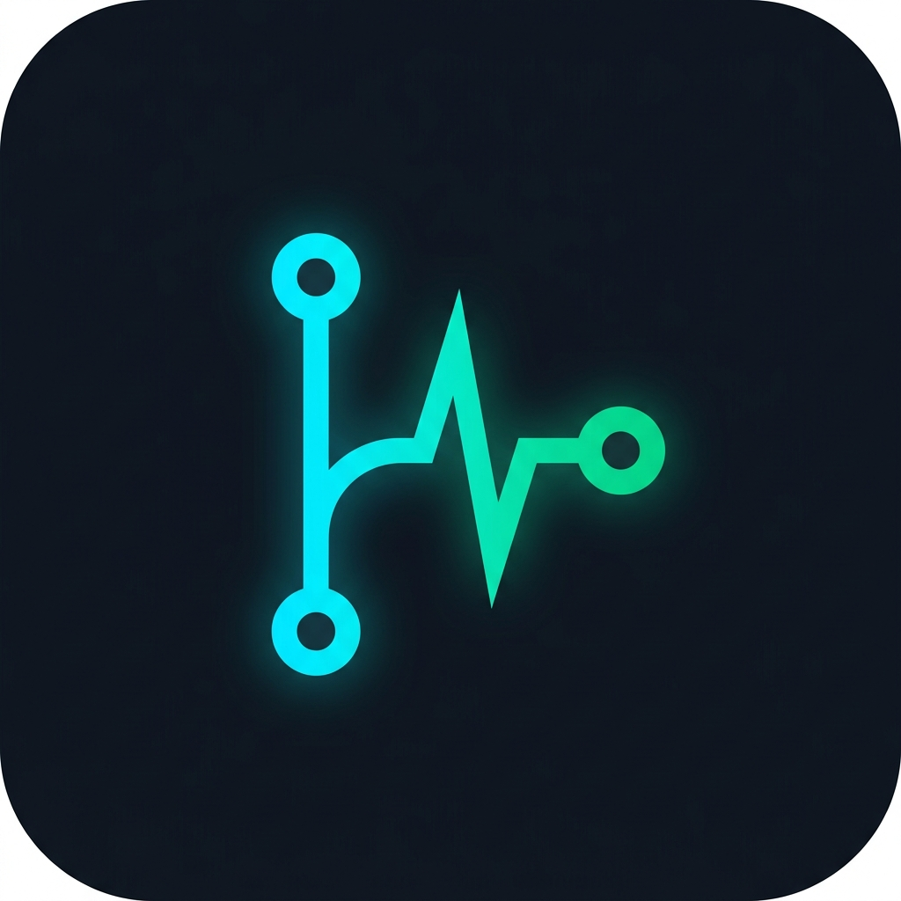

# GitPulse Mobile

<p align="center">
  
</p>

<div align="center">
  
  
  
  <a href="https://github.com/zerabyte88/gitpulse_mobile/releases"></a>
  <a href="LICENSE"></a>
</div>

<br/>

**GitPulse Mobile** is an on-device developer telemetry, 24-hour activity rhythm, and GitHub productivity analytics application for Android (`com.gitpulse.gitpulse_mobile`). Built with Flutter and powered by hardware-accelerated charting via `fl_chart`, it transforms raw GitHub REST API v3 payloads into intuitive developer rhythms, cumulative portfolio impact telemetry, and habit-based commit tiers. Engineered for performance and privacy, all data processing, charting, and storage occur **100% on-device** with zero intermediary proxy servers.

---

## Key Features

### 1. 24-Hour Productivity Rhythm & Diurnal Analytics
- **Local Timezone Binning:** Converts UTC event timestamps from the GitHub API into the user's local device timezone (00:00–23:00).
- **Hardware-Accelerated Histogram:** Renders an interactive 24-bar activity histogram using `fl_chart` to reveal peak engineering hours and temporal workflow patterns.
- **Diurnal Distribution Analysis:** Identifies whether a developer operates as an early bird, mid-day builder, or late-night committer based on live event frequency.

### 2. Language Footprint & Portfolio Analytics
- **Weighted Language Distribution:** Multi-language donut chart weighted by repository codebase volume with authentic GitHub language colors.
- **Portfolio Telemetry Aggregation:** Real-time summation of cumulative stargazers, forks, repository counts (original vs. forked), and follower ratios.
- **Sliver Virtualization:** Butter-smooth 60/120 FPS scrolling across 100+ repositories using `CustomScrollView` and `SliverList.builder`.

### 3. Native In-App Repository Explorer & Code Viewer
- **Instant In-App Inspection:** Tap any repository from a user's portfolio or the news feed to open it directly inside the app—no external browser redirect required.
- **Dual-Tab Experience:** Seamlessly toggle between **README** documentation and the **Files** codebase tree.
- **Interactive Directory Tree:** Browse nested folders and subdirectories with custom breadcrumbs and type-specific folder/file iconography (`GitHubContentItem`).
- **Syntax-Highlighted In-App File Viewer:** Inspect source files directly with line numbering, file size metadata, character counts, and quick actions to copy code or open on GitHub (`FileViewerScreen`).

### 4. Rich Markdown Engine with Theme-Adaptive Assets
- **Automatic Relative Asset Resolution:** Automatically resolves relative paths (e.g., `./assets/preview.png`, `docs/architecture.svg`) against GitHub's raw CDN (`raw.githubusercontent.com/<owner>/<repo>/<branch>/`).
- **Dark/Light Theme Adaptive Images:** Supports GitHub context markers such as `#gh-dark-mode-only` and `#gh-light-mode-only` matching the user's active theme.
- **Precision Typography:** Renders badges, tables, task lists, blockquotes, and fenced code blocks with pixel-perfect on-device typography.

### 5. Commit Activity Tier Engine & Dynamic Visuals
- **6-Level Animated Tier Badges:** Continuous streak and annual contribution volume ranking (`Code Titan`, `Relentless Committer`, `Consistent Builder`, `Weekend Warrior`, `Dormant Explorer`, `Fresh Sprout`).
- **Dynamic Theme Particle System:** GPU-accelerated Canvas particle background in `AppBar.flexibleSpace` tailored to each active theme:
  - **Dark (Midnight Navy):** Flowing water ripples & ambient bubbles.
  - **AMOLED (Pure Black):** Crescent moon & twinkling stars in deep space.
  - **AMOLED Sakura 🌸:** Falling sakura blossom petals with swaying wind physics.
  - **Light (GitHub Pure):** Autumn falling leaves with rotational drift.
- **Bespoke GitPulse Vector Logo:** Intertwines Git branch topology, cardiac ECG heartbeat waveform, and a traveling electric energy spark (`GitPulseLogo`).
- **Developer Easter Egg:** Tap the AMOLED card **10 times in rapid succession** in Settings to unlock the secret AMOLED Sakura mode.

### 6. Over-The-Air (OTA) Updates & Safe Storage Cleanup
- **Automated GitHub Releases Updater:** In-app version verification, background APK download with live progress bar via `ota_update`, and automated installation dispatch via Android `PackageInstaller`.
- **Targeted Safe Deletion Guard:** Scans `/Download/GitPulse/` upon startup and purges only matching GitPulse APKs where `fileVersion <= currentVersion`. User photos, documents, and other downloads remain completely untouched.

### 7. Multi-Language Internationalization & Privacy
- **6 Supported Languages:** Complete translation coverage switchable on-the-fly without app restarts:
  - 🇮🇩 Indonesian (Bahasa Indonesia)
  - 🇺🇸 English
  - 🇯🇵 Japanese (日本語)
  - 🇨🇳 Simplified Chinese (简体中文)
  - 🇹🇼 Traditional Chinese (繁體中文)
  - 🇰🇷 Korean (한국어)
- **Smart Rate-Limit Interceptor:** Strongly-typed handler for HTTP 403, 429, and exhausted rate limits with optional Personal Access Token (PAT) support stored in Android's private app sandbox.
- **Zero Intermediary Servers & Total Privacy:** Direct device-to-GitHub TLS 1.3 queries with zero analytics SDKs, trackers, or telemetry scripts.

---

## Commit Activity Tier Matrix

Developers receive a continuous animated tier badge based on their commit streak and annual contribution volume (`ContributionStats.determineTitle`):

| Tier Level | Badge Title | Qualifying Criteria | Real-Time Canvas Shader Effect |
| :--- | :--- | :--- | :--- |
| **Tier 1** | **Code Titan** | `Streak >= 14d` or `Max >= 30d` or `Year >= 350` | 🔥 **Blazing Flame & Magma Physics**: Vertical heatwave shader with rising ember sparks |
| **Tier 2** | **Relentless Committer** | `Streak >= 5d` or `Max >= 14d` or `Year >= 100` | ⚡ **Electric Plasma Arc**: High-voltage electrical crackle with fast micro-sparks |
| **Tier 3** | **Consistent Builder** | `Streak >= 2d` or `Max >= 7d` or `Year >= 30` | 💻 **Emerald Cyber Matrix**: Digital scanline beam sweep with matrix illumination |
| **Tier 4** | **Weekend Warrior** | `Streak >= 1d` or `Max >= 2d` or `Year >= 8` | ☀️ **Solar Amber Shimmer**: Radiant golden sunburst with sweeping angular gleam |
| **Tier 5** | **Dormant Explorer** | `This Year > 0` or `Total Contributions > 0` | ✨ **Cosmic Starlight Nebula**: Calm cosmic drift with gently pulsating stellar dust |
| **Tier 6** | **Fresh Sprout** | *Default / 0 Contributions Recorded* | 🌱 **Spring Dewdrop**: Gentle organic scale breathing with spring dew shimmer |

---

## Architecture and Tech Stack

| Component | Technology | Description |
| :--- | :--- | :--- |
| **Application ID** | `com.gitpulse.gitpulse_mobile` | Android package identifier |
| **UI Framework** | Flutter 3.24+ (Dart 3.5+) | High-performance cross-platform declarative UI framework |
| **Visual Charts** | `fl_chart` (v1.2.0) | Hardware-accelerated 24h activity histogram and language donut charts |
| **Markdown Engine** | `flutter_markdown` (v0.7.7+1) | Native in-app GitHub README markdown parsing with CDN asset resolution |
| **Networking** | `http` (v1.6.0) | Composable HTTP client for GitHub REST API v3 queries & rate limit tracking |
| **OTA Delivery** | `ota_update` (v7.1.0) | In-app background APK downloader & Android PackageInstaller integration |
| **Typography** | `google_fonts` (Inter) | Professional typography and clean typeface rendering |
| **Local Persistence** | `shared_preferences` (v2.5.5) | On-device sandboxed key-value store for bookmarks, themes, & tokens |
| **Internationalization** | `intl` (v0.20.3) | Reactive 6-language localization & date/number formatting |
| **Verification Suite** | `flutter_test` | Comprehensive test coverage (39/39 passing unit and widget tests) |

---

## Build & Compilation

GitPulse Mobile is compiled specifically for modern **64-bit ARM (`arm64-v8a`)** architectures for peak memory and rendering efficiency, eliminating legacy 32-bit and heavy x86 binary overhead.

### Local APK Build Command

```bash
flutter build apk --release --split-per-abi --target-platform android-arm64
```

The compiled release APK will be generated at:
`build/app/outputs/flutter-apk/app-arm64-v8a-release.apk`

---

# Version History

### v1.0.13 (Build 14)
* **Settings Sheet Visual Polish:** Refined settings sheet layout and theme option cards with responsive layout geometry and smooth touch states.
* **Header Canvas Fine-Tuning:** Polished particle physics parameters and alpha blending across all 4 theme modes.
* **Test Suite Verification:** Updated widget tests to ensure 100% passing test matrix (39/39 tests).

### v1.0.12 (Build 13)
* **Native In-App Repository Explorer:** Added dual-tab repository screen toggling between README documentation and interactive file tree without external browser redirects.
* **Syntax-Highlighted File Viewer:** Added `FileViewerScreen` with line numbering, file metadata, character count, and copy action.
* **Relative Asset Resolution:** Automatic resolution of relative image paths in README files against GitHub raw CDN with dark/light mode image marker support.
* **Expanded Multi-Language Dictionary:** Full localization dictionary coverage for repository explorer, file viewer, and directory navigation across all 6 languages.

### v1.0.11 (Build 12)
* *Internal test build and hotfix staging.*

### v1.0.10 (Build 11)
* **Header Animation Pause on Modals:** Implemented `HeaderAnimationState` to suspend background Canvas particle loops when settings or modals open, reducing idle background GPU/CPU usage to 0%.
* **Zero-saveLayer Optimization:** Replaced offscreen GPU `ShaderMask` allocations with native concentric GPU alpha rings to prevent frame drops on low-tier devices.

### v1.0.9 (Build 10)
* **Curated Tech News & Ecosystem Feed:** Aggregated trending GitHub repositories and dev.to articles with category filtering chips and constrained thumbnail cache decoding (`cacheWidth: 450`).

### v1.0.8 (Build 9)
* **6-Language Internationalization Overhaul:** Added complete dictionary translations for Bahasa Indonesia, English, Japanese, Simplified Chinese, Traditional Chinese, and Korean.

### v1.0.7 (Build 8)
* *Internal test build and localization verification.*

### v1.0.6 (Build 7)
* **In-App OTA Updater & Safe Storage Pipeline:** Integrated background APK downloading via `ota_update` with automated startup cleanup of installed update binaries in `/Download/GitPulse/`.
* **Android PackageInstaller Integration:** Configured secure `FileProvider` and Android permissions for seamless in-place APK installation.

### v1.0.5 (Build 6)
* *Internal test build and OTA pipeline verification.*

### v1.0.4 (Build 5)
* **Commit Activity Tier Engine:** Added 6-tier continuous animated badges (Code Titan, Relentless Committer, Consistent Builder, Weekend Warrior, Dormant Explorer, Fresh Sprout) with physics-based shaders.
* **4 Dynamic Theme Modes:** Introduced Dark (Navy), Pure Black AMOLED, Clean Light, and secret AMOLED Sakura mode unlocked via 10-tap gesture.

### v1.0.3 (Build 4)
* *Internal test build and theme asset tuning.*

### v1.0.2 (Build 3)
* *Internal test build and analytics layout adjustments.*

### v1.0.1 (Build 2)
* **24-Hour Activity Rhythm & Portfolio Analytics:** 24-bar diurnal activity histogram, language footprint donut chart, and cumulative stargazer/fork portfolio telemetry.
* **Sliver Virtualization:** `CustomScrollView` and `SliverList.builder` for smooth 60fps scrolling across 100+ repositories.

### v1.0.0 (Build 1)
* **Initial Release:** Initial project setup, base architecture, and GitHub API connection pipeline.

---

## License

This project is licensed under the **MIT License**. Please see the [LICENSE](LICENSE) file for full license terms.

---

<div align="center">
  <br/>
  <a href="https://github.com/zerabyte88">
    
  </a>
  <br/>
  <sub>Developed with ❤️ by <a href="https://github.com/zerabyte88">zerabyte88</a> (Creator & Maintainer)</sub>
</div>
